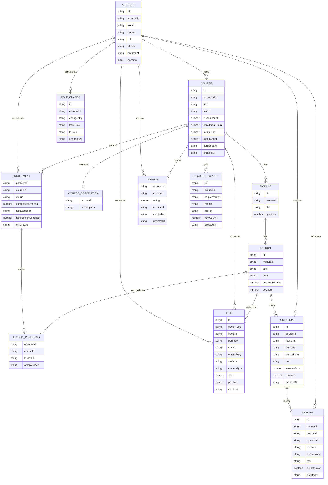

# Modelo de dados

Documento da história PLAN-3. Segue o processo de `dynamodb-single-table-design`: ERD → lista de padrões de acesso → quadro de entidades (PK/SK) → índices secundários → desnormalização e contadores → validação.

As decisões que justificam cada parte estão em `PLANNING.md` (número da pergunta entre parênteses).

## 1. ERD

Tipos genéricos e sem chaves: as chaves saem do passo 3. O item de unicidade `EMAIL#` e os itens de idempotência da fila são físicos e não aparecem aqui.



### Valores fechados

| Atributo | Valores | Decisão |
|---|---|---|
| `Account.role` | `student`, `instructor`, `admin` | Q20, Q43 |
| `Account.status` | `PENDING`, `ACTIVE`, `DISABLED` (`DELETED` como evolução) | Q39, Q56 |
| `Course.status` | `DRAFT`, `PUBLISHED`, `ARCHIVED` | Q10 |
| `Enrollment.status` | `ACTIVE`, `CANCELLED` | Q49 |
| `File.ownerType` | `account`, `course`, `lesson` | Q53 |
| `File.purpose` | `avatar` (conta), `cover` (curso), `attachment` e `video` (aula) | Q53, Q54 |
| `File.status` | `PENDING`, `UPLOADED`, `PROCESSED`, `FAILED` | Q53 |

### Regras que o modelo precisa respeitar

- Uma avaliação por par aluno + curso, que sobrevive ao cancelamento (Q47).
- Rematrícula reativa a mesma matrícula e mantém o progresso (Q49).
- Curso publicado ganha aulas, não perde; curso em rascunho pode ser apagado com módulos e aulas, sem progresso a perder (Q24, Q51).
- Avatar e capa: um atual por dono; trocar apaga os arquivos antigos (Q50, Q53).
- Só matrícula `ACTIVE` acessa material e vídeo (Q58).
- Sem versionamento de curso (Q59).

## 2. Padrões de acesso

Revisão da Q22 com o escopo atual (Q65 a Q68). As colunas de índice, chaves e operação são preenchidas nos passos 3 e 4.

| # | Padrão | Filtro / ordem | Quem | Frequência |
|---|---|---|---|---|
| 1 | Buscar conta por id (`internalId`) | — | sistema (trigger de token, toda rota privada) | alta |
| 1b | Verificar e-mail livre / buscar conta por e-mail | e-mail exato | sistema (sign-up), admin | baixa |
| 2 | Listar usuários | por papel e status, mais recentes primeiro, paginado | admin | baixa |
| 3 | Criar, editar, publicar, arquivar, apagar curso em rascunho ou arquivado | — | instrutor | baixa |
| 4 | Cursos de um instrutor | todos os estados, mais recentes primeiro | instrutor | média |
| 5 | Catálogo | publicados, mais recentes primeiro, paginado | público | alta |
| 6 | Curso completo | curso + módulos + aulas em ordem de posição + capa | público | alta |
| 7 | Criar, editar, reordenar, apagar módulos e aulas | — | instrutor | média |
| 8 | Matricular, cancelar, rematricular | — | aluno | média |
| 8b | Buscar a matrícula de um aluno num curso | aluno + curso | sistema (todo acesso a aula, material e vídeo) | **crítica** |
| 9 | Minhas matrículas | só ativas, com título e progresso, mais recentes primeiro | aluno | alta |
| 10 | Alunos de um curso | só ativos, paginado; o CSV lê todos | instrutor | baixa |
| 11 | Marcar aula como concluída, uma vez só | — | aluno | alta |
| 12 | Meu progresso num curso | aulas concluídas + última aula e posição | aluno | alta |
| 13 | Avaliar e editar a avaliação | uma por aluno + curso | aluno | baixa |
| 14 | Avaliações de um curso | mais recentes primeiro, paginado | público | média |
| 15 | Buscar cursos por texto, e outras ordens do catálogo | Algolia | público | média |
| 16 | Salvar a posição no vídeo | a cada 15 a 30 s | aluno | **crítica** |
| 17 | Histórico de papéis de uma conta | mais recentes primeiro | admin | baixa |
| 18 | Arquivo atual de um dono por finalidade | avatar da conta, capa do curso, vídeo da aula | sistema, público | alta |
| 19 | Materiais de uma aula | em ordem de posição | aluno ativo | média |
| 20 | Arquivo por id | atualizar o status pelo trigger do S3 | sistema | média |
| 21 | Exportação por id (a lista das exportações de um curso fica adiada, Q425) | — | instrutor | baixa |
| 22 | Abrir uma aula | conteúdo, vídeo e materiais; só matrícula ativa | aluno | alta |
| 23 | Perguntas de uma aula | mais novas primeiro, paginado | matriculado, dono, admin | alta |
| 24 | Respostas de uma pergunta | mais antigas primeiro, paginado | matriculado, dono, admin | alta |
| 25 | Perguntar, responder, apagar pergunta ou resposta | — | matriculado, dono, admin | média |
| 26 | Perguntas e respostas de um autor | todas, para copiar o nome novo | sistema (`PATCH /me`) | baixa |
| 27 | Emitir e consumir o ticket de tempo real | uma vez só, em 30 s | quem lê a aula; sistema (`$connect`) | média |
| 28 | Conexões ao vivo de uma aula | as não vencidas | sistema (a cada pergunta ou resposta) | alta |
| 29 | Conexões ao vivo de uma conta | as não vencidas; de um curso, ao cancelar | sistema (sair, sign-in novo, troca de senha, desativar, cancelar a matrícula) | baixa |
| 30 | Caixa de notificações | mais novas primeiro, paginada, sem as vencidas; contagem das não lidas até 100 | dono da caixa | alta |
| 31 | Marcar uma ou todas como lidas | — | dono da caixa | média |
| — | Conta `PENDING` vencida, upload `PENDING` abandonado, exportação de mais de 7 dias, ticket e conexão de tempo real, notificação de mais de 90 dias | TTL, sem query | sistema | — |

Fora do DynamoDB, de propósito: outras ordens e filtros do catálogo vão para o Algolia (Q66); busca de usuários por nome espera o painel de admin (Q67).

Pontos críticos para o passo 3 (Q68): o padrão 16 grava num item à parte, pequeno, para não reescrever a matrícula; o padrão 8b é um `GetItem` pela chave aluno + curso, sem índice.

## 3. Quadro de entidades

Tabela `MainTable` com `PK` e `SK`, e dois índices globais sobrecarregados, `GSI1` (`GSI1PK`, `GSI1SK`) e `GSI2` (`GSI2PK`, `GSI2SK`). Todo item leva `type`; as entidades com identidade própria levam `id`, e os itens de associação (Enrollment, Review, LessonProgress, CoursePosition) levam os ids das duas pontas. Ids são KSUID, que ordenam por tempo (`dynamodb-key-design`), com resolução de um segundo: ids do mesmo segundo ficam na ordem da parte aleatória, então "mais recentes primeiro" vale entre segundos, não dentro de um. Decisões: Q71 a Q78.

| Entidade | PK | SK | GSI1PK / GSI1SK | GSI2PK / GSI2SK |
|---|---|---|---|---|
| Account | `ACCOUNT#<accountId>` | `ACCOUNT#<accountId>` | `ROLE#<role>` / `ACCOUNT#<accountId>` | `EMAIL#<email>` / `ACCOUNT#<accountId>` |
| RoleChange | `ACCOUNT#<accountId>` | `ROLE_CHANGE#<changeId>` (KSUID) | | |
| Course | `COURSE#<courseId>` | `COURSE#<courseId>` | `INSTRUCTOR#<instructorId>` / `COURSE#<courseId>` | só publicados: `CATALOG#<0..3>` / `<publishedAt>#<courseId>` |
| CourseDescription (Q298, Q307) | `COURSE#<courseId>` | `DESCRIPTION` | | |
| Module (com `lessonCount`, Q288) | `COURSE#<courseId>` | `MODULE#<moduleId>` | | |
| Lesson (sumário) | `COURSE#<courseId>` | `MODULE#<moduleId>#LESSON#<lessonId>` | | |
| LessonContent | `LESSON#<lessonId>` | `CONTENT` | | |
| Enrollment | `ACCOUNT#<accountId>` | `ENROLLMENT#<courseId>` | só ativas: `COURSE#<courseId>` / `ENROLLMENT#<enrolledAt>#<accountId>` | só ativas: `ENROLLMENTS#<accountId>` / `<enrolledAt>#<courseId>` (Q268) |
| SentMail (e-mail do domínio, Q350, Q360) | `ACCOUNT#<accountId>` | `MAIL#<kind>` ou `MAIL#<kind>#<ref>` (`MAIL#welcome`, `MAIL#course-archived#<courseId>`) | | |
| CoursePosition (posição, Q280) | `ACCOUNT#<accountId>` | `PROGRESS#<courseId>` | | |
| LessonProgress | `ACCOUNT#<accountId>` | `PROGRESS#<courseId>#LESSON#<lessonId>` | | |
| Review | `ACCOUNT#<accountId>` | `REVIEW#<courseId>` | `COURSE#<courseId>` / `REVIEW#<createdAt>#<accountId>` | |
| File (`avatar` na conta, `cover` no curso, `attachment` na aula com `name` e `position`, `video` na aula com `size` declarado e `uploadId` do multipart; `expiresAt` de 24 horas enquanto `PENDING` ou `FAILED`, Q381, e de 2 dias no vídeo `PENDING`, Q436) | `<OWNER>#<ownerId>` (`ACCOUNT#<accountId>`, `COURSE#<courseId>` ou `LESSON#<lessonId>`, ao lado do `CONTENT`) | `FILE#<purpose>#<fileId>` | | |
| StudentExport (`expiresAt` de 7 dias, como o lifecycle do CSV, Q425) | `EXPORT#<exportId>` | `EXPORT#<exportId>` | | |
| Question (Q650) | `LESSON#<lessonId>` | `QUESTION#<questionId>` | só não removidas: `AUTHOR#<accountId>` / `POST#<questionId>` | |
| Answer (Q650) | `LESSON#<lessonId>` | `ANSWER#<questionId>#<answerId>` | `AUTHOR#<accountId>` / `POST#<answerId>` | |
| RealtimeTicket (só o SHA-256 do ticket, `expiresAt` de 30 s, 8.3) | `TICKET#<hash>` | `TICKET#<hash>` | | |
| RealtimeConnection (`apiId`, `accountId`, `courseId` e `lessonId` só com aula, `expiresAt` de 2 h 15 min, 8.3) | `CONNECTION#<connectionId>` | `CONNECTION#<connectionId>` | só com aula: `REALTIME#LESSON#<lessonId>` / `CONNECTION#<connectionId>` | `REALTIME#ACCOUNT#<accountId>` / `CONNECTION#<connectionId>` |
| Notification (`kind`, `courseTitle`, `lessonTitle`, `actorName`, `byInstructor`, `exportId` no `export-ready` (8.8), `readAt`, `expiresAt` de 90 dias; id KSUID do horário do evento com o hash de tipo, origem e destinatário, 8.4) | `INBOX#<accountId>` | `NOTIFICATION#<id>` | só não lidas: `UNREAD#<accountId>` / `NOTIFICATION#<id>` | |

### Itens físicos que não são entidades

- **Reserva de e-mail** (Q78): `PK = SK = EMAIL_CLAIM#<email normalizado>`, com `accountId`. Gravada e movida só pelo `AccountRepository`, na mesma transação da Account, com `attribute_not_exists(PK)`. Não entra em índice. Sai junto com a Account, numa transação em que a remoção da reserva exige `accountId` igual ao da conta: uma compensação nunca libera um e-mail que outra conta segura (1.4.e). Na confirmação, conta e reserva perdem o `expiresAt` na mesma transação, e a conta vira `ACTIVE` só se ainda estiver `PENDING` (Q139).

### Regras de escrita

- Toda escrita que toca mais de um item é uma transação (Q71).
- A troca de papel atualiza `role` e `GSI1PK` da Account, só com a conta `ACTIVE` e ainda no papel de origem, e grava o `RoleChange` na mesma transação (Q173); o primeiro admin tem `changedBy = bootstrap`.
- A posição de módulos e aulas é atributo; o padrão 6 ordena no código (posição, depois id). Mover aula de módulo é delete + put do sumário em transação; o conteúdo (`LESSON#l`/`CONTENT`) não muda de chave. O `PUT /outline` grava só o que muda e recusa mais de 100 operações (Q227).
- O módulo conta as próprias aulas (`lessonCount`) nas mesmas transações que criam, apagam e movem aula; o `ADD` exige o módulo, e apagar exige `lessonCount = 0`, então nenhuma aula fica num módulo apagado (Q288). Mover aula é condicionado ao título e à duração lidos (Q289). As rotas de edição leem o outline com leitura forte.
- Cópias de nome (`instructorName`, `studentName`) são propagadas um item por vez, 4 em paralelo, sem transação, com `<campo> <> :nome` e a condição falha ignorada (Q290).
- Criar aula grava sumário, conteúdo e `ADD lessonCount` no curso numa transação; apagar faz o inverso, só em rascunho (Q24, Q223). Depois da transação, apagar leva o material: os `FILE` da partição `LESSON#l` e depois os objetos sob `lesson/<id>/` (Q416, Q421). Toda escrita em módulo ou aula leva a condição "curso no mesmo status" na transação.
- Criações usam `attribute_not_exists(PK)` (aula concluída uma vez, uma avaliação por par, unicidade do e-mail).
- O e-mail é normalizado (trim, minúsculas) antes de entrar em qualquer chave.
- A troca de status (desativar, reativar) exige o chamador admin `ACTIVE` por `ConditionCheck` na mesma transação (Q194); desativar remove a `session` na mesma escrita (Q212).
- O curso nasce `DRAFT` com `lessonCount` e `enrollmentCount` zerados e `instructorName` copiado da conta (Q204); `ratingSum`/`ratingCount` só entram com as avaliações (Q112). A edição exige `status <> ARCHIVED` na própria escrita, com `ReturnValuesOnConditionCheckFailure` para separar curso inexistente de arquivado.
- A descrição do curso fica em `COURSE#c` / `DESCRIPTION`, só quando tem texto (ausente é `''`), para o item do curso ficar abaixo de 1 KB: um `ADD` nos contadores custa 1 WCU na tabela e 1 no `GSI1`, contra 6 e 6 com 5.000 caracteres no item (medido no DynamoDB Local, Q312). Criar com descrição é uma transação com o curso; o `PATCH` da descrição leva o `Update` do título ou um `ConditionCheck` do curso (existe e não arquivado) e um `Put`, ou um `Delete` quando ela vira `''` (Q309). O `scripts/backfill-course-descriptions.js` migra cursos no formato antigo (Q310); em 2026-10-17 o `dev` não tinha nenhum curso gravado (o `--dry-run` não achou nada a mover).
- Apagar um rascunho (3.7) ou um arquivado (8.7) é um `Update` condicionado a `status IN (DRAFT, ARCHIVED)` que grava `status = DELETING` e remove as chaves do `GSI1`; daí em diante o repositório lê o curso como ausente (Q368, Q369). O stream leva o curso à fila `…-course-deletion`, e o job apaga, uma página de até 100 itens por mensagem, a descrição, os módulos, os sumários de aula e a partição `LESSON#l` inteira de cada aula (conteúdo e material), e por último o item do curso, condicionado a `DELETING` (Q371, Q417). Os objetos no S3 de cada aula (`lesson/<id>/`) saem antes da página, e os do curso (`course/<id>/`, capa e variantes) antes do item do curso. `DELETING` não é status do domínio: só a escrita e o job o conhecem.
- No arquivado, o job começa pelo `GSI1` `COURSE#c`: cada matrícula ativa sai com os itens `PROGRESS#c*` do aluno (posição e aulas concluídas, na partição `ACCOUNT#a`), e cada avaliação sai também; matrícula cancelada e o seu progresso ficam. Só então vêm a partição do curso e as aulas (Q743). Arquivar grava `archivedAt` no curso, e o `DELETE` é recusado por 1 hora depois dele (`COURSE_RECENTLY_ARCHIVED`), para o e-mail de arquivamento alcançar os alunos antes de as matrículas sumirem (Q753); curso arquivado antes da 8.7 não tem `archivedAt` e pode ser apagado já.
- Publicar grava `status`, `publishedAt` e `GSI2PK`/`GSI2SK` (`CATALOG#<k>` / `<publishedAt>#<courseId>`, com `k` = primeiro byte do SHA-256 do id, módulo 4: o curso cai sempre na mesma partição, Q613) num `Update` condicionado a `status = DRAFT AND lessonCount > 0`; arquivar exige `status = PUBLISHED` e remove as chaves do `GSI2` (Q232, Q233). A página pública lê a partição `COURSE#c` inteira numa `Query` (padrão 6).
- A `session` (`accessJti`, `refreshTokenHash` = SHA-256 do refresh token) é a sessão única da conta (Q210, Q211): o sign-in a substitui, o refresh a troca só com condição `session.refreshTokenHash = :anterior`, e o reset de senha e a desativação a removem. O adapter das rotas privadas exige a claim `jti` igual a `session.accessJti`. Só existe no item com alguém conectado.
- Matricular é `Put` condicional da Enrollment (`ACTIVE`, chaves do `GSI1`) + `ADD enrollmentCount 1` com o curso `PUBLISHED`; rematricular volta `CANCELLED` → `ACTIVE` e regrava o `GSI1` e o `GSI2` com o `enrolledAt` original; cancelar volta `ACTIVE` → `CANCELLED`, remove o `GSI1` e o `GSI2` e faz `ADD -1` exigindo só que o curso exista (Q243). A propagação do `studentName` lê a partição `ACCOUNT#a`, não o índice, para alcançar também as canceladas.
- Perguntar é um `Put` condicional da pergunta, na transação que confirma a matrícula `ACTIVE`; responder é o `Put` da resposta + `ADD answerCount 1` na pergunta com `removed = false` (a matrícula entra quando quem responde não é o dono). Apagar a pergunta sem respostas a apaga com `answerCount = 0`; com respostas, um `Update` com `answerCount > 0` grava `removed`, esvazia texto e nome e tira as chaves do `GSI1`; condição falha é `409 CONFLICT`. Apagar a resposta leva `ADD answerCount -1` condicionado ao contador lido; a última resposta de uma pergunta removida apaga a pergunta junto (Q653). As perguntas e respostas ficam na partição `LESSON#l`, que o job de apagar curso já leva inteira (Q655).
- O `externalId` (o `sub` do Cognito) nasce vazio e é gravado na Account depois do `SignUp` (1.4.f); o atributo só existe no item quando preenchido.

### Como cada padrão é servido

| # | Padrão | Índice | Chave | Operação |
|---|---|---|---|---|
| 1 | Conta por id | tabela | `ACCOUNT#a` / `ACCOUNT#a` | Get; forte no trigger de pre token, a cada sign-in e refresh (Q88, Q145); eventual em `GET`/`PATCH /me` (Q166); `PATCH` com Update `ALL_NEW` (Q167) |
| 1b | Conta por e-mail | `GSI2` | `EMAIL#e` | Query (o índice nasce com o primeiro uso, Q144) |
| 1c | Conta por e-mail pela reserva (confirmação, reenvio, recuperação de senha; o use case confere o status) | tabela | `EMAIL_CLAIM#e`, depois `ACCOUNT#a` | Dois Get fortes; item vencido conta como ausente (Q137, Q142) |
| 2 | Usuários por papel | `GSI1` | `ROLE#r` | Query, de trás para frente; status por filtro |
| 4 | Cursos do instrutor | `GSI1` | `INSTRUCTOR#i` | Query, de trás para frente |
| 5 | Catálogo | `GSI2` | `CATALOG#0` a `CATALOG#3` | Uma Query de trás para frente por partição, em paralelo, juntadas por `GSI2SK`; a página seguinte pede `GSI2SK < <último da página>` (Q614) |
| 6 | Curso completo | tabela | `COURSE#c` | Query (curso, módulos, aulas, capa) |
| 8b | Matrícula aluno + curso | tabela | `ACCOUNT#a` / `ENROLLMENT#c` | Get |
| 9 | Minhas matrículas | `GSI2` | `ENROLLMENTS#a` | Query, de trás para frente, + `BatchGet` dos cursos da página (Q80, Q268) |
| 10 | Alunos do curso | `GSI1` | `COURSE#c`, `begins_with ENROLLMENT#` | Query |
| 11 | Concluir aula | tabela | `ACCOUNT#a` / `PROGRESS#c#LESSON#l` | Put condicional + `ADD completedLessons` na matrícula `ACTIVE` + `ConditionCheck` do conteúdo da aula, em transação (Q278) |
| 12 | Meu progresso | tabela | `ACCOUNT#a`, `begins_with PROGRESS#c` | Query (posição e aulas concluídas juntas) + contador da matrícula (Q279) |
| 13 | Minha avaliação | tabela | `ACCOUNT#a` / `REVIEW#c` | Get forte; criar: Put condicional + `ADD ratingSum, ratingCount` + `ConditionCheck` da matrícula; editar: Update condicionado à nota lida + `ADD` da diferença, em transação (Q282) |
| 14 | Avaliações do curso | `GSI1` | `COURSE#c`, `begins_with REVIEW#` | Query, de trás para frente; só curso publicado, sem `accountId` na resposta (Q283) |
| 16 | Salvar posição | tabela | `ACCOUNT#a` / `PROGRESS#c` | Get forte da matrícula + Put por cima, sem transação (Q280) |
| 17 | Histórico de papéis | tabela | `ACCOUNT#a`, `begins_with ROLE_CHANGE#` | Query, de trás para frente |
| 18 | Arquivo atual do dono | tabela | `<OWNER>#o`, `begins_with FILE#<purpose>#` | Query |
| 19, 22 | Abrir aula, materiais, vídeo | tabela | `LESSON#l` | Query da partição (conteúdo, `FILE#attachment#` e `FILE#video#`, separados pela finalidade, Q449) em paralelo com o curso e a matrícula (8b); o vídeo atual é o `UPLOADED` de id mais novo (Q451) |
| 20 | Arquivo por id | tabela | derivada da chave do S3 | Get |
| 21 | Exportação por id | tabela | `EXPORT#e` | Get |
| 23 | Perguntas da aula | tabela | `LESSON#l`, `begins_with QUESTION#` | Query, de trás para frente, paginada (Q650) |
| 24 | Respostas da pergunta | tabela | `LESSON#l`, `begins_with ANSWER#q#` | Query, paginada (Q650) |
| 25 | Perguntar, responder, apagar | tabela | `LESSON#l` / `QUESTION#q`, `ANSWER#q#r` | Get forte da pergunta ou resposta; responder e apagar resposta em transação com o `answerCount` (Q653) |
| 26 | Perguntas e respostas do autor | `GSI1` | `AUTHOR#a` | Query de todas as páginas + um `Update` por item (Q654) |
| 27 | Ticket de tempo real | tabela | `TICKET#h` | Put condicional ao emitir; no `$connect`, `Delete` condicionado a existir com `ALL_OLD`, recusado se vencido (o TTL apaga dias depois) |
| 28 | Conexões da aula | `GSI1` | `REALTIME#LESSON#l` | Query de todas as páginas com filtro `expiresAt > agora`; a conexão sai pelo `$disconnect` ou quando o envio responde `GoneException` |
| 29 | Conexões da conta | `GSI2` | `REALTIME#ACCOUNT#a` | Query com o mesmo filtro (e o `courseId` no código, ao cancelar); apaga cada item e depois fecha o socket (`DeleteConnection`), em melhor esforço: uma falha vai para o log e não desfaz a ação |
| 30 | Caixa | tabela e `GSI1` | `INBOX#a`; `UNREAD#a` | Query de trás para frente com filtro `expiresAt > agora`, paginada; a contagem é um Query no índice de trás para frente com `Select: COUNT` e `Limit: 100` (o `Limit` vale antes do filtro: as vencidas, as mais antigas, ficam por último) |
| 31 | Marcar como lida | tabela e `GSI1` | `INBOX#a` / `NOTIFICATION#n`; `UNREAD#a` | `Update` condicionado a existir: `SET readAt = if_not_exists(readAt, :agora) REMOVE GSI1PK, GSI1SK`; todas: as não lidas do índice, até 1.000, 10 por vez |

## 4. Índices secundários

| Índice | Chaves | Projeção | Quem usa |
|---|---|---|---|
| `GSI1` | `GSI1PK`, `GSI1SK` | `ALL` | Account por papel (2), cursos do instrutor (4), alunos ativos (10, esparso), avaliações (14), perguntas e respostas do autor (26, esparso: a pergunta removida perde a chave), conexões ao vivo da aula (28), notificações não lidas (30, esparso: marcar como lida tira a chave) |
| `GSI2` | `GSI2PK`, `GSI2SK` | `ALL` | Conta por e-mail (1b), catálogo (5, esparso: só cursos publicados), minhas matrículas (9, esparso: só ativas), conexões ao vivo da conta (29) |

Os dois são genéricos: a entidade escreve os atributos de índice que precisa e o prefixo separa os padrões (Q79). Uma matrícula cancelada perde `GSI1PK`/`GSI1SK` e `GSI2PK`/`GSI2SK`; um curso que deixa de estar publicado perde `GSI2PK`/`GSI2SK`.

## 5. Cópias e contadores

Cada valor duplicado tem um tipo e um dono (`dynamodb-denormalization`; Q80 a Q84).

| Atributo | Em | Tipo | Dono |
|---|---|---|---|
| `studentName` | Enrollment, Review | exibição | A rota que renomeia a conta: uma query forte por prefixo (`ENROLLMENT#`, `REVIEW#`) em `ACCOUNT#a`, um `Update` por item (Q290) |
| `instructorName` | Course | exibição | A rota que renomeia a conta: cursos do instrutor pelo `GSI1` |
| `authorName` | Question, Answer | exibição | A rota que renomeia a conta: perguntas e respostas do autor pelo `GSI1` (`AUTHOR#a`), pelo `copyName` (Q654) |
| registro do curso no Algolia (`title`, `description`, `instructorName`, `publishedAt`) | índice `<stage>_courses` | cópia externa | O indexador, pela fila `index` (Q314 a Q316) |
| `cover` (`fileId`, `variants`) | Course | exibição | O processador de imagem, na transação que marca o `FILE` como `PROCESSED` (Q85) |
| `pendingExportId`, `pendingExportAt` | Course | trava | O pedido de exportação, na transação que grava o `StudentExport`; o job limpa ao terminar; vale por 15 minutos (Q427) |
| `avatar` (`fileId`, `variants`) | Account | exibição | O mesmo, para o avatar (Q85) |
| `enrollmentCount` | Course | contador | Matricular, cancelar, rematricular (`ADD` na transação) |
| `lessonCount` | Course | contador | Acrescentar e apagar aula (`ADD` na transação) |
| `ratingSum`, `ratingCount` | Course | contador | Criar avaliação; editar soma a diferença (`ADD` na transação) |
| `completedLessons` | Enrollment | contador | Concluir aula (`ADD` na transação, com o put condicional do progresso) |
| `answerCount` | Question | contador | Responder e apagar resposta (`ADD` na transação, condicionado à pergunta não removida, ou ao valor lido ao apagar) (Q653) |
| `byInstructor` | Answer | retrato | Gravado ao responder: o autor é o dono do curso |
| `rating`, `comment` | Review | retrato | Escritos pelo aluno; não seguem nada |
| `fromRole`, `toRole` | RoleChange | retrato | Escritos uma vez |
| `enrolledAt` | Enrollment | retrato | Escrito na primeira matrícula; a rematrícula não muda |
| `fileKey` | StudentExport | retrato | O job de exportação |
| título, capa, total de aulas do curso | (não copiados) | referência | "Minhas matrículas" lê os cursos por `BatchGet` |
| entradas de `GSI1` e `GSI2` | índices | índice | O DynamoDB, a cada escrita |

Percentual de progresso e média de avaliação são calculados na leitura, nunca gravados. Contadores nunca dependem do stream; o stream só alimenta cópias externas (Algolia, limpeza do Cognito).

### Stream e cópia no Algolia (3.2)

- A tabela tem stream `NEW_AND_OLD_IMAGES` com um leitor só, `routeTableChanges` (Q302). O filtro na origem deixa passar `Course` e `CourseDescription` (o par `NewImage.type` / `REMOVE` com `OldImage.type`).
- O roteador envia `{ courseId }` à fila FIFO `coursary-api-<stage>-index.fifo` (grupo = `courseId`, deduplicação = `eventID`) só quando muda o que o índice guarda: a visão `title`, `instructorName`, `publishedAt` de um curso publicado (nula fora de `PUBLISHED`) ou o texto da descrição. Contadores e edições de rascunho não geram mensagem (Q315).
- O indexador lê curso e descrição com leitura forte e copia o estado atual: publicado → `saveObject` com `objectID = courseId`; qualquer outro estado ou curso ausente → `deleteObject` (Q316). Por isso uma mensagem atrasada, repetida ou devolvida por redrive não estraga nada.
- Falhas: lote do stream perdido depois de 3 tentativas vai, só com a posição, para `…-stream-failures` (alarme; reparo com `reindexCatalog`); mensagem da fila `index` que falha 5 vezes vai para `…-index-dlq.fifo` (alarme; redrive). Os alarmes avisam por e-mail num tópico SNS (Q296, Q317).
- Limpeza do Cognito (3.4): o roteador também recebe as remoções de `Account` `PENDING` e envia à fila padrão `…-cognito-cleanup` só as feitas pelo TTL (`userIdentity` `Service` / `dynamodb.amazonaws.com`, conferido no código). O consumidor procura o usuário pelo e-mail com `ListUsers` e o apaga só se o `custom:internalId` for o da conta vencida e ele estiver `UNCONFIRMED` (Q341 a Q343). `sweepUnconfirmedUsers` repara lotes perdidos (Q345).
- E-mails do domínio (3.5): o roteador envia `{ kind: 'welcome', accountId }` à fila padrão `…-mail` quando uma conta passa de `PENDING` a `ACTIVE`. O consumidor `sendMail` relê a conta com leitura forte e só envia se ainda `ACTIVE`; o item `ACCOUNT#a` / `MAIL#welcome` é a reserva (`SENDING` com prazo de 2 minutos, depois `SENT` com o `sesMessageId`), que torna a mensagem repetida inofensiva (Q349, Q350). O arquivamento de um curso (3.6) vira um `course-archived-fanout` na mesma fila; cada execução lê uma página de até 100 matrículas ativas no `GSI1`, enfileira um `course-archived` por aluno e a próxima página com o cursor; cada aluno é reservado em `MAIL#course-archived#<courseId>` (Q358 a Q361).
- Tempo real na aula (8.3): o filtro também deixa passar `Question` e `Answer`. O roteador junta o lote por aula e envia à fila padrão `…-realtime` um `{ lessonId, questionIds, listChanged }` por aula (uma resposta grava a resposta e o contador da pergunta no mesmo lote). O consumidor `pushRealtimeChanges` (antes `pushLessonChanges`) lê as conexões da aula (28) e posta, 10 por vez, `{ type: 'answers', lessonId, questionId }` por pergunta respondida ou, sem nenhuma, `{ type: 'questions', lessonId }`: só o aviso, nunca o texto, e o cliente recarrega pelo HTTP. `GoneException` apaga a conexão; outro erro mantém a conexão e devolve a mensagem à fila, que depois de 5 vezes vai para `…-realtime-dlq` (alarme).
- Notificações (8.4): o filtro também deixa passar `LessonContent` (não o resumo `Lesson`, que mover a aula de módulo grava de novo). O roteador manda à fila padrão `…-notifications` um `answer` e um `question` para cada resposta e pergunta inseridas, um `lesson` para cada conteúdo de aula inserido e um `archived` para o curso que passa de publicado a arquivado, os dois últimos com o horário do registro. Um `StudentExport` que passa de `PENDING` a `READY` vira um `export-ready` com o horário do registro (8.8); `StudentExport` entrou na lista de tipos do primeiro filtro, que já deixava passar inserção e mudança, e o filtro só da inserção saiu (Q759). O consumidor `notifyAccounts` grava uma notificação por destinatário com `attribute_not_exists`, com id determinístico (repetição e redrive não gravam de novo): o autor da pergunta (salvo se ele mesmo respondeu), o dono do curso, quem pediu o CSV dos alunos (o id do aviso vem do export), e os alunos ativos de 100 em 100 (a próxima página volta à fila) quando o curso está no status certo. As contas que ganharam notificação vão à fila `…-realtime`, e `pushRealtimeChanges` posta `{ type: 'notifications' }` às conexões delas (`GSI2`). Falha de 5 vezes vai para `…-notifications-dlq` (alarme).
- A busca (`GET /search`, 3.3) pede ao Algolia só os `objectID` na ordem de relevância e lê os cursos pelo `BatchGet` (`CourseRepository.findManyByIds`, até 100 chaves, com nova tentativa das não processadas); o que a tabela não tem mais publicado é descartado e logado (`SearchHitDropped`). Os totais e a página (a partir de 0) são os do Algolia (Q326, Q327). Configuração do índice em `scripts/apply-algolia-settings.js` (Q329).

### Formato da cópia de imagem (Q85)

```json
"avatar": {
  "fileId": "2Pz91m",
  "variants": {
    "64": "account/2NxK8q/avatar/2Pz91m/64-a1b2c3.webp",
    "256": "account/2NxK8q/avatar/2Pz91m/256-d4e5f6.webp"
  }
}
```

Guarda chaves do S3, não URLs: a classe de resposta (`AccountProfile`) monta a URL pela porta `PublicAssetUrls`, com o domínio da CDN (4.1). Trocar a imagem é uma transação que marca o `FILE` novo como `PROCESSED`, aponta a cópia para ele e apaga o `FILE` antigo, com a condição "o `fileId` atual ainda é o antigo".

## 6. Validação

Lista percorrida contra o quadro de entidades em 2026-10-14:

- Os 22 padrões de leitura saem por Get ou Query; nenhum Scan. Filtros só no status da lista de usuários (Q76) e nas matrículas ativas (Q74).
- Regras de negócio em transações com condição: matricular exige curso `PUBLISHED` (condição no update do contador do curso); concluir aula e avaliar exigem matrícula `ACTIVE` (`ConditionCheck`).
- Operações com mais de 100 itens (apagar curso em rascunho ou arquivado) são feitas em duas etapas: transação que marca `DELETING` e job idempotente em lotes (Q86).
- Para a PLAN-4: a limpeza do Cognito (Q41) lê o `externalId` da conta apagada pelo TTL, então o stream precisa de `NEW_AND_OLD_IMAGES`.
