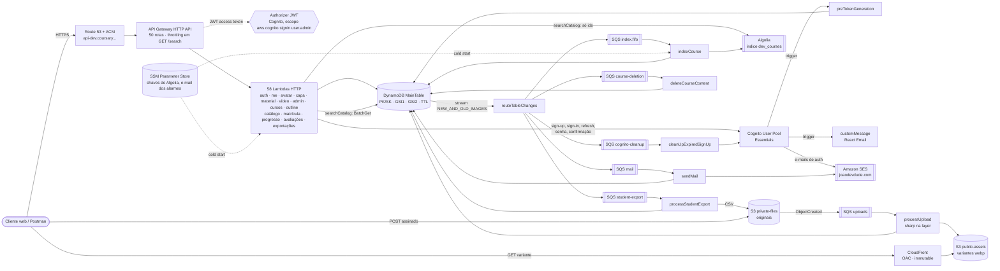
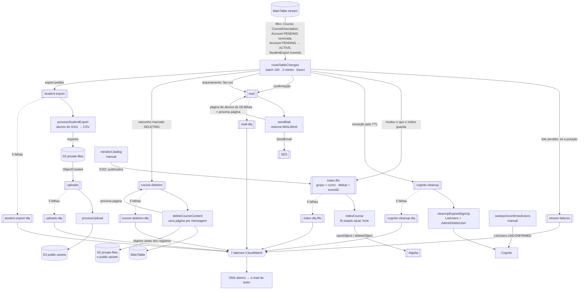
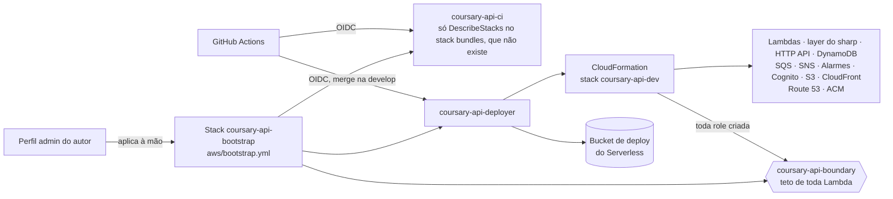

# System design

Todos os recursos que a Coursary API usa e como eles se comunicam. Atualizado a cada história que muda um recurso, uma fila, uma função ou um fluxo (regra no `CLAUDE.md`, Q366). Inventário conferido no template empacotado (`pnpm exec serverless package --stage dev`) e no `aws/bootstrap.yml`. Versão em página: https://claude.ai/artifact/QCf14uyJkj4eKMqpy625QZ.

Estado: `feat/6.1-api-for-browser` (fase 4: avatar, capa do curso e material da aula com S3, sharp e CloudFront; apagar aula ou rascunho leva os arquivos junto; CSV de alunos. Fase 5: envio do vídeo da aula em multipart; assistir por URL assinada e remover. Fase 6: API pronta para o navegador e o site em `dev.coursary.joaodevdude.com`).

## Em números

| Recurso | Quantidade |
|---|---|
| Funções Lambda (Node 24, arm64, 512 MB; `processUpload` com 1024 MB) | 70 |
| Rotas no HTTP API | 58 (46 privadas); CORS só para a origem do site, com credenciais |
| Tabelas DynamoDB | 1 (`GSI1`, `GSI2`, stream, TTL) |
| Filas SQS | 13 (6 de trabalho, 6 DLQs, 1 de falhas do stream) |
| Buckets S3 | 3 (`private-files` com os originais, os vídeos e os CSVs de alunos, `public-assets` com as variantes, `site` com o front) |
| Distribuições CloudFront | 2 (imagens no domínio padrão; site em `dev.coursary.joaodevdude.com` com o certificado `*.joaodevdude.com` de `us-east-1` e uma CloudFront Function de rotas), OAC, `PriceClass_All` |
| Layers Lambda | 1 (sharp para linux-arm64) |
| Alarmes CloudWatch | 9, num tópico SNS (7 de filas e stream, 2 de reputação do SES) |
| Serviços externos | Algolia, SES |

## Visão geral

O cliente fala com o HTTP API, com o bucket privado (só por um POST assinado) e com a CDN (variantes públicas). Tudo o que acontece depois de uma escrita (índice de busca, limpeza do Cognito, e-mails, exclusão de rascunhos, CSV de alunos) sai do stream da tabela por um único roteador, que distribui para uma fila por consumidor. A tabela é a fonte da verdade (Q38); Cognito, Algolia e SES obedecem a ela.

## Caminho assíncrono: stream, roteador e filas

Um leitor só no stream (Q302). O filtro na origem deixa passar apenas o que interessa a algum consumidor; o roteador decide no código e manda cada evento para a fila do seu consumidor. Cada fila tem DLQ e alarme; o lote que o roteador abandona vai para a fila de falhas.

| Fila | Tipo | Produtor | Consumidor | Garantia |
|---|---|---|---|---|
| `index.fifo` | FIFO, visibilidade 180 s | roteador, `reindexCatalog` | `indexCourse` (lote 10, para na 1ª falha) | Ordem por curso; o indexador copia o estado atual |
| `cognito-cleanup` | Padrão | roteador | `cleanUpExpiredSignUp` | Apaga só se `custom:internalId` bate e o usuário está `UNCONFIRMED` |
| `mail` | Padrão | roteador; o próprio `sendMail` (fan-out do arquivamento) | `sendMail` (`welcome`, `course-archived-fanout`, `course-archived`; no máximo 2 execuções, pelo ritmo do SES) | Reserva `ACCOUNT#a` / `MAIL#kind[#ref]` com prazo de 2 min |
| `course-deletion` | Padrão | roteador; o próprio `deleteCourseContent` (próxima página) | `deleteCourseContent` (lote 5) | Só apaga curso em `DELETING`; item ausente conta como apagado; curso por último |
| `student-export` | Padrão, visibilidade 720 s | roteador (inserção de `StudentExport`) | `processStudentExport` (lote 1, timeout de 120 s) | Lê o export antes de agir: já terminado, ignora; repetido, regrava a mesma chave |
| `uploads` | Padrão, visibilidade 180 s | S3 (notificação do bucket privado) | `processUpload` (lote 5, no máximo 2 execuções) | Lê o `FILE` antes de agir: repetido, substituído ou sem registro não estraga nada |
| `stream-failures` | Padrão, 14 dias | Lambda (destino de falha) | ninguém: alarme | Recuperação por `reindexCatalog` e `sweepUnconfirmedUsers` |
| 6 DLQs | Como a fila de origem, 14 dias | SQS, após 5 recebimentos | ninguém: alarme e redrive | `StartMessageMoveTask` depois de corrigir a causa |

## Fluxos principais

**Cadastro e confirmação** (Q39, Q139, Q341, Q349)
1. `POST /auth/sign-up` grava a conta `PENDING` e a reserva do e-mail (TTL de 3 dias) numa transação.
2. `SignUp` no Cognito; o trigger `customMessage` escreve o e-mail do código, que sai pelo SES.
3. A confirmação marca `ACTIVE`; o stream leva à fila `mail`, e `sendMail` manda as boas-vindas.
4. Se ninguém confirma, o TTL apaga a conta e `cleanUpExpiredSignUp` apaga o usuário do Cognito.

**Sessão no navegador** (Q467, Q481 a Q484, Q488)
1. `POST /auth/sign-in` exige o `Origin` do site (contra login CSRF, Q489), responde `{ accessToken, expiresIn }` e grava o refresh token no cookie `coursary_refresh` (`HttpOnly; Secure; SameSite=Lax; Path=/auth`, 30 dias), preso ao host da API.
2. `POST /auth/refresh` lê só o cookie e exige `Origin` igual à origem do site (403 sem ele): `SameSite=Lax` ainda manda o cookie de outro subdomínio do mesmo site. Responde como o sign-in, com o cookie do token novo.
3. `POST /auth/sign-out` (rota privada: o access token diz a conta) apaga a sessão, o que derruba o access token na hora, revoga o refresh token do cookie no Cognito e devolve o cookie expirado; 204 sempre.
4. O CORS da HTTP API e do bucket privado aceita só a origem do site; o front local usa o proxy do Vite, sem `localhost` no CORS.

**Site** (Q474, Q475, Q480, Q486)
1. Bucket privado `site`, lido só pela distribuição por OAC; alias `dev.coursary.joaodevdude.com` com o certificado `*.joaodevdude.com` da conta, em `us-east-1`; registros A e AAAA no Route 53.
2. Uma CloudFront Function leva caminhos sem extensão ao `/index.html`, menos os de `/.well-known/`; um arquivo ausente responde o próprio erro.
3. O CI do `coursary-web` lê o bucket e a distribuição em `/coursary-api/dev/site/*` no SSM, sobe o build (`immutable` nos arquivos com hash, `no-cache` no `index.html`) e invalida só o `index.html`.

**Rota privada** (Q210, Q301)
1. O HTTP API exige access token com o escopo `aws.cognito.signin.user.admin`; um id token recebe 403.
2. O adapter lê a conta, confere a sessão única (`jti`) e o status.
3. O controller valida com Zod; o caso de uso grava com transação e condições.

**Publicar e buscar** (Q314, Q316, Q326)
1. Publicar põe o curso no `GSI2` (catálogo) e, pelo stream, na fila `index.fifo`.
2. `indexCourse` lê o curso e a descrição com leitura forte e grava no Algolia.
3. `GET /search` pede ao Algolia só os ids e completa pelo `BatchGet` na tabela.

**Arquivar** (Q358 a Q364)
1. Arquivar tira o curso do `GSI2` e, pelo stream, do Algolia.
2. O roteador põe um `course-archived-fanout` na fila `mail`; cada execução lê uma página de até 100 matrículas ativas no `GSI1`, enfileira um aviso por aluno e a próxima página.
3. Cada aluno é reservado em `MAIL#course-archived#<courseId>` e só recebe se a conta e a matrícula continuarem ativas; o instrutor não recebe.

**Avatar** (Q378 a Q394)
1. `POST /me/avatar` grava o `FILE` `PENDING` (TTL de 24 horas) e só então assina um POST para `account/<id>/avatar/<fileId>/original` no bucket privado, preso ao tipo e a até 5 MB, válido por 5 minutos.
2. O cliente posta o arquivo direto no S3; a notificação `ObjectCreated` vai para a fila `uploads`.
3. `processUpload` lê o `FILE` com leitura forte: sem registro, apaga o objeto; já processado, ignora; senão lê o original preso ao ETag do evento, gera 64 e 256 em webp com o sharp (só JPEG, PNG e WebP decodificados, até 16 MP), grava as variantes no bucket público com nome pelo conteúdo e `immutable`, e numa transação marca o `FILE` `PROCESSED`, copia `avatar` na conta (condição: o avatar ainda é o lido) e apaga o `FILE` anterior. Depois apaga o original e as variantes antigas.
4. Imagem inválida termina `FAILED`, sem avatar, e o original é apagado.
5. `GET /me` monta `avatarUrl` com o domínio da CDN (`CDN_DOMAIN`).

**Capa do curso** (Q399 a Q404)
1. `POST /courses/{courseId}/cover` segue a regra de editar o curso (dono ou admin, não arquivado), grava o `FILE` em `COURSE#c` e assina o POST para `course/<courseId>/cover/<fileId>/original`, até 10 MB.
2. `processUpload` faz 480 × 270 e 1280 × 720 com `fit: inside` e copia `cover` no curso pelo dono da cópia da finalidade (`CourseCoverOwner`); a condição recusa um curso em `DELETING`, e a capa dele é descartada.
3. `coverUrl` aparece no catálogo, na busca, na página do curso, na lista do instrutor, em minhas matrículas e nas respostas do instrutor; as queries montam as URLs com o `CDN_DOMAIN`.

**Material da aula** (Q406 a Q412)
1. `POST /courses/{courseId}/lessons/{lessonId}/attachments` (quem edita o curso) conta os arquivos da aula (até 20), grava o `FILE` em `LESSON#l` com nome e posição e assina o POST para `lesson/<lessonId>/attachment/<fileId>/original`, até 50 MB.
2. `processUpload` confere o tamanho com um `HeadObject` preso ao ETag do evento (sem baixar o arquivo) e marca `UPLOADED`, sem sharp nem cópia em dono.
3. Abrir a aula lê conteúdo e material numa Query da partição `LESSON#l` e lista os enviados, na ordem.
4. `GET …/attachments/{fileId}` (quem pode abrir a aula, matrícula lida com leitura forte) assina um GET de 5 minutos com o nome original; `PUT …/attachments/order` regrava as posições numa transação; `DELETE` apaga o registro e depois o objeto.
5. Apagar a aula (rascunho, Q416): depois da transação, a própria requisição apaga os `FILE` da partição e depois os objetos sob `lesson/<lessonId>/` nos dois buckets (registros antes: um upload que chega no meio não acha registro e o `processUpload` o apaga, Q421); uma falha aí só deixa lixo inalcançável e vira o log `LessonMaterialLeft`.

**Vídeo da aula: envio** (Q432 a Q447)
1. `POST /courses/{courseId}/lessons/{lessonId}/video` `{ contentType, size }` (quem edita o curso; só MP4, até 2 GiB) aborta o upload ainda `PENDING` da aula e apaga o registro dele, abre o `CreateMultipartUpload` em `lesson/<lessonId>/video/<fileId>/original` e só então grava o `FILE` `PENDING` com o tamanho e o `uploadId` (TTL de 2 dias). Responde 201 `{ fileId, partSize, partCount }`, partes de 16 MiB.
2. `POST …/video/part-urls` `{ fileId, partNumbers }` assina até 100 `UploadPart` de 1 hora, cada um preso ao tamanho exato da parte; o cliente faz `PUT` de cada parte direto no S3 e guarda o `ETag`.
3. `POST …/video/complete` `{ fileId, parts }` confere que a lista nomeia cada parte uma vez e chama `CompleteMultipartUpload` com o tamanho gravado (`MpuObjectSize`); depois de confirmado, repetir responde 201 de novo. Timeout de 120 s: a API responde em até 30 s, a função termina o trabalho.
4. O `ObjectCreated` cai na fila `uploads`; `processUpload` lê o tamanho por `HeadObject`, marca `UPLOADED` e apaga registro e objeto dos vídeos mais antigos da aula; um vídeo confirmado depois de um mais novo é descartado (`outdated`, Q445).
5. `POST …/video/abort` `{ fileId }` aborta (e confere com `ListParts` que nenhuma parte ficou) e apaga o registro. Upload esquecido: a regra de lifecycle `abort-forgotten-uploads` aborta em 1 dia em `lesson/`.

**Vídeo da aula: assistir e remover** (Q449 a Q454)
1. Abrir a aula lê a partição `LESSON#l` numa Query e separa material e vídeos pela finalidade. Quem pode abrir a aula (matrícula ativa, também em curso arquivado; dono e admin) recebe `video: { url, expiresIn }` do `UPLOADED` de id mais novo: um GET assinado inline (`video/mp4`), que o player lê por faixas (`Range`, 206).
2. A URL vale 2 horas, limitadas ao que resta da sessão da role que assina menos 5 minutos, quando a credencial informa esse prazo. Na Lambda ela não informa (não há `AWS_CREDENTIAL_EXPIRATION`), então a URL sai com 2 horas e pode morrer antes, com a sessão (`ExpiredToken`); o cliente abre a aula de novo quando o `expiresIn` acaba ou quando o S3 responde 403 (Q455).
3. `DELETE /courses/{courseId}/lessons/{lessonId}/video` (quem edita o curso) apaga os registros dos vídeos enviados e depois os objetos; 404 `VIDEO_NOT_FOUND` sem vídeo. Um envio em andamento continua.

**CSV de alunos** (Q384, Q423 a Q430)
1. `POST /courses/{courseId}/exports` (dono ou admin, também em curso arquivado) grava o `StudentExport` `PENDING` e marca o curso com `pendingExportId` numa transação; outro pedido com um pendente de menos de 15 minutos recebe 409 `EXPORT_PENDING`. Responde 202.
2. O stream leva a inserção à fila `student-export`.
3. `processStudentExport` lê o curso (forte), pagina os alunos ativos no `GSI1`, grava `exports/<courseId>/<exportId>.csv` no bucket privado (`name,enrolledAt,completedLessons,progress`, sem e-mail, BOM UTF-8, proteção contra fórmula), marca `READY` e limpa o pendente do curso. Curso apagado: `FAILED`.
4. `GET /exports/{exportId}` (quem gerencia o curso; senão 404) devolve o status e, em `READY`, um GET assinado de 5 minutos; um `PENDING` de mais de 15 minutos aparece `FAILED`. O CSV expira por lifecycle e o item pelo TTL, os dois em 7 dias.

**Apagar rascunho** (Q368 a Q373)
1. `DELETE /courses/{courseId}` marca o rascunho `DELETING` e o tira do `GSI1`; responde 202 e, daí em diante, o curso é 404 em toda rota.
2. O roteador põe o curso na fila `course-deletion`.
3. `deleteCourseContent` lê uma página por mensagem (descrição, módulos, aulas), apaga os objetos de cada aula da página (`lesson/<id>/`) e só então os itens, cada aula com a partição `LESSON#l` inteira (conteúdo e material). Quando só resta o curso, apaga `course/<courseId>/` nos dois buckets (capa e variantes) e depois o item do curso (Q417). Objetos antes dos registros: uma mensagem repetida ainda acha o que apagar.

## Funções

| Grupo | Funções | Gatilho | Role |
|---|---|---|---|
| Auth | signUp, confirmSignUp, resendConfirmationCode, signIn, refreshTokens, signOut (privada), forgotPassword, resetPassword | HTTP | Compartilhada; únicas com o secret do app client; `signIn` e `refreshTokens` também com `SITE_ORIGIN` (`sls/config/session.yml`) |
| Triggers do Cognito | preTokenGeneration, customMessage | Cognito | Próprias (evita o ciclo pool → role → pool) |
| Conta e admin | getMe, updateMe (com `CDN_DOMAIN`), requestAvatarUpload (role própria: `GetItem`, `PutItem`, `s3:PutObject` em `account/*` do bucket privado), listAccounts, findAccountByEmail, changeRole, listRoleChanges, disableAccount, enableAccount | HTTP privado | Compartilhada |
| Cursos e outline | createCourse, updateCourse, listMyCourses (os três com `CDN_DOMAIN`, como publishCourse, archiveCourse, listCatalog, getCoursePage, searchCatalog e listMyEnrollments), requestCoverUpload (role própria: `GetItem`, `PutItem`, `s3:PutObject` em `course/*`), publishCourse, archiveCourse, deleteCourse, create/update/deleteModule, create/updateLesson, deleteLesson (role própria: `GetItem`, `UpdateItem`, `DeleteItem`, `Query`, `s3:ListBucket` nos dois buckets, `s3:DeleteObject` em `lesson/*`), getOutline, reorderOutline | HTTP privado | Compartilhada |
| Catálogo | listCatalog, getCoursePage, searchCatalog | HTTP público | Compartilhada; `searchCatalog` própria (só a chave de busca) |
| Matrícula, progresso, avaliações | enroll, cancelEnrollment, listMyEnrollments, listCourseStudents, openLesson, completeLesson, getProgress, savePosition, reviewCourse, getMyReview, listCourseReviews | HTTP (lista de avaliações pública) | Compartilhada; `openLesson` própria (`GetItem`, `Query` e `s3:GetObject` em `lesson/*`, para assinar o vídeo, Q453) |
| Material da aula | requestAttachmentUpload, getAttachmentDownload, deleteAttachment, reorderAttachments | HTTP privado | Próprias para as três que tocam o S3 (`s3:PutObject`, `s3:GetObject` ou `s3:DeleteObject` só em `lesson/*`); `reorderAttachments` na compartilhada |
| Vídeo da aula | requestVideoUpload, signVideoParts, completeVideoUpload (120 s), abortVideoUpload, deleteVideo | HTTP privado | Próprias (`deleteVideo`: `s3:DeleteObject` em `lesson/*`): `s3:PutObject` em `lesson/*` para abrir, assinar e completar; `s3:AbortMultipartUpload` e `s3:ListMultipartUploadParts` em `lesson/*` para abortar (também no início, que aborta o pendente) |
| Exportações | requestStudentExport (`GetItem`, `PutItem`, `UpdateItem`), getStudentExport (`GetItem`, `s3:GetObject` em `exports/*`) | HTTP privado | Próprias |
| Assíncronas | routeTableChanges, indexCourse, cleanUpExpiredSignUp, sendMail, deleteCourseContent, processUpload, processStudentExport | Stream, SQS (`processUpload`: fila `uploads`, lote 5, no máximo 2 execuções, layer do sharp, `GetObject`/`DeleteObject` no privado, `PutObject`/`DeleteObject` no público, `Query` na partição da aula para a troca do vídeo; `deleteCourseContent`: `s3:ListBucket` nos dois buckets, `s3:DeleteObject` em `course/*` e `lesson/*` do privado e `course/*` do público; `processStudentExport`: fila `student-export`, lote 1, 120 s, `Query` no `GSI1`, `s3:PutObject` em `exports/*`) | Próprias, mínimas (`sendMail`: conta, matrícula, curso, `Query` no `GSI1`, envio na fila `mail`, `ses:SendEmail`) |
| Manuais | promoteAdmin, reindexCatalog, sweepUnconfirmedUsers | `sls invoke` | Próprias |
| Saúde | health | HTTP público | Compartilhada |

## Dados

| Recurso | O que guarda | Detalhes |
|---|---|---|
| MainTable | Contas, reservas de e-mail, cursos, descrições, módulos, aulas, conteúdo, matrículas, progresso, avaliações, histórico de papéis, e-mails enviados | On-demand; `GSI1` (papel, cursos do instrutor, alunos ativos, avaliações); `GSI2` (e-mail, catálogo, minhas matrículas); TTL em `expiresAt`; stream. Chaves em `docs/data-model.md` |
| Cognito User Pool | Credenciais e `custom:internalId` | Plano Essentials; e-mail como usuário; envio pelo SES; app client com secret |
| Algolia `<stage>_courses` | Cópia de busca dos cursos publicados | `{ objectID, title, description, instructorName, publishedAt }`; atributos buscáveis em ordem: título, instrutor, descrição |
| S3 `coursary-api-<stage>-private-files-<conta>` | Originais enviados pelo POST assinado | Acesso público bloqueado; notificação `ObjectCreated` em `account/`, `course/` e `lesson/` para a fila `uploads`; lifecycle de 7 dias em `exports/` e de 1 dia para uploads multipart incompletos em `lesson/`; CORS só para a origem do site (`POST`, `PUT`, `ETag` exposto); `Retain` em `prod` |
| S3 `coursary-api-<stage>-site-<conta>` | O build do front | Acesso público bloqueado; lido só pela distribuição do site (OAC) |
| S3 `coursary-api-<stage>-public-assets-<conta>` | Variantes webp (`<dono>/<id>/<finalidade>/<fileId>/<tamanho>-<hash>.webp`) | Só a distribuição lê (OAC com `AWS:SourceArn`); `Cache-Control: public, max-age=31536000, immutable` |
| SSM Parameter Store | `/coursary-api/<stage>/algolia/{app-id, write-key, search-key}` e `alarm-email` | Chaves em `SecureString`, lidas no cold start; o e-mail dos alarmes é lido pelo CloudFormation no deploy |

## Deploy e segurança da conta

O merge na `develop` deploya `dev` pelo GitHub Actions. Os grupos de log das Lambdas guardam 30 dias (Q456); cada função leva o source map do seu bundle, com `--enable-source-maps`, e um erro aponta para a linha do `.ts` (Q457). O SES tem alarmes de taxa de bounce (5%) e de reclamação (0,1%), medidas da conta inteira (Q461). Antes de empacotar, `pnpm build:layers` monta a layer do sharp com binários linux-arm64 e confere versão e arquitetura (Q387). Nenhuma credencial fica no CI: as roles são assumidas por OIDC, e toda role que o deploy cria passa por um boundary.

| Limite | Valor | Onde |
|---|---|---|
| Execuções simultâneas de Lambda | 1.000 (era 10 até 2026-10-18) | Service Quotas, Q339 |
| Throttling de `GET /search` | 5 por segundo, rajada de 10 (aproximado) | Stage `$default`, Q328 e Q348 |
| Envio do SES | Fora do sandbox, 50 mil por dia, 14 por segundo; `sendMail` limitado a 2 execuções | Conta SES, Q367 |
| Filtros do roteador | 4 de 5 usados (o arquivamento entra pelo filtro de `Course`) | Event source mapping |
