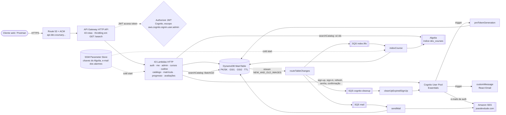
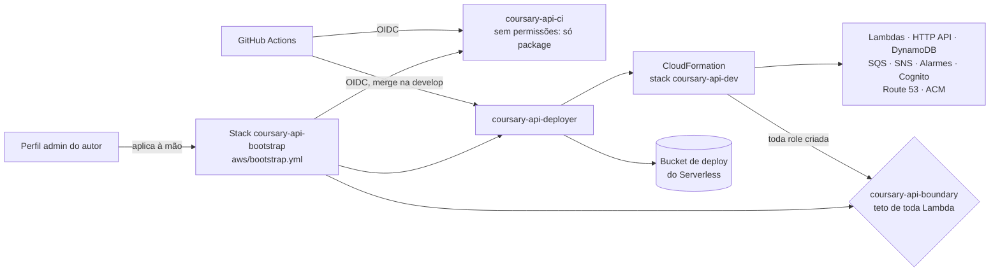

# System design

Todos os recursos que a Coursary API usa e como eles se comunicam. Atualizado a cada história que muda um recurso, uma fila, uma função ou um fluxo (regra no `CLAUDE.md`, Q366). Inventário conferido no template empacotado (`pnpm exec serverless package --stage dev`) e no `aws/bootstrap.yml`. Versão em página: https://claude.ai/artifact/QCf14uyJkj4eKMqpy625QZ.

Estado: `develop` depois da 3.5; a 3.6 (aviso de arquivamento) está em andamento.

## Em números

| Recurso | Quantidade |
|---|---|
| Funções Lambda (Node 24, arm64, 512 MB) | 52 |
| Rotas no HTTP API | 43 (31 privadas) |
| Tabelas DynamoDB | 1 (`GSI1`, `GSI2`, stream, TTL) |
| Filas SQS | 7 (3 de trabalho, 3 DLQs, 1 de falhas do stream) |
| Alarmes CloudWatch | 4, num tópico SNS |
| Serviços externos | Algolia, SES |

## Visão geral

O cliente só fala com o HTTP API. Tudo o que acontece depois de uma escrita (índice de busca, limpeza do Cognito, e-mails) sai do stream da tabela por um único roteador, que distribui para uma fila por consumidor. A tabela é a fonte da verdade (Q38); Cognito, Algolia e SES obedecem a ela.



## Caminho assíncrono: stream, roteador e filas

Um leitor só no stream (Q302). O filtro na origem deixa passar apenas o que interessa a algum consumidor; o roteador decide no código e manda cada evento para a fila do seu consumidor. Cada fila tem DLQ e alarme; o lote que o roteador abandona vai para a fila de falhas.

```mermaid
flowchart TB
  ddb[(MainTable stream)] -->|filtro: Course, CourseDescription,<br/>Account PENDING removida,<br/>Account PENDING → ACTIVE| router[routeTableChanges<br/>batch 100 · 2 retries · bisect]
  router -->|lote perdido: só a posição| fail[[stream-failures]]
  router -->|mudou o que o índice guarda| idx[[index.fifo<br/>grupo = curso · dedup = eventID]]
  router -->|remoção pelo TTL| cln[[cognito-cleanup]]
  router -->|confirmação| mail[[mail]]
  router -. 3.6 .-> mail
  idx --> indexCourse[indexCourse<br/>lê estado atual, forte] -->|saveObject / deleteObject| algolia[[Algolia]]
  cln --> cleanUp[cleanUpExpiredSignUp<br/>ListUsers + AdminDeleteUser] --> cognito[Cognito]
  mail --> sendMail[sendMail<br/>reserva MAIL#kind] -->|SendEmail| ses[[SES]]
  idx -.->|5 falhas| idxDlq[[index-dlq.fifo]]
  cln -.->|5 falhas| clnDlq[[cognito-cleanup-dlq]]
  mail -.->|5 falhas| mailDlq[[mail-dlq]]
  fail & idxDlq & clnDlq & mailDlq --> alarms{4 alarmes CloudWatch} --> sns[SNS alarms → e-mail do autor]
  reindex[reindexCatalog<br/>manual] -->|GSI2: publicados| idx
  sweep[sweepUnconfirmedUsers<br/>manual] -->|ListUsers UNCONFIRMED| cognito
```

| Fila | Tipo | Produtor | Consumidor | Garantia |
|---|---|---|---|---|
| `index.fifo` | FIFO, visibilidade 180 s | roteador, `reindexCatalog` | `indexCourse` (lote 10, para na 1ª falha) | Ordem por curso; o indexador copia o estado atual |
| `cognito-cleanup` | Padrão | roteador | `cleanUpExpiredSignUp` | Apaga só se `custom:internalId` bate e o usuário está `UNCONFIRMED` |
| `mail` | Padrão | roteador (e o fan-out da 3.6) | `sendMail` | Reserva `ACCOUNT#a` / `MAIL#kind` com prazo de 2 min |
| `stream-failures` | Padrão, 14 dias | Lambda (destino de falha) | ninguém: alarme | Recuperação por `reindexCatalog` e `sweepUnconfirmedUsers` |
| 3 DLQs | Como a fila de origem, 14 dias | SQS, após 5 recebimentos | ninguém: alarme e redrive | `StartMessageMoveTask` depois de corrigir a causa |

## Fluxos principais

**Cadastro e confirmação** (Q39, Q139, Q341, Q349)
1. `POST /auth/sign-up` grava a conta `PENDING` e a reserva do e-mail (TTL de 3 dias) numa transação.
2. `SignUp` no Cognito; o trigger `customMessage` escreve o e-mail do código, que sai pelo SES.
3. A confirmação marca `ACTIVE`; o stream leva à fila `mail`, e `sendMail` manda as boas-vindas.
4. Se ninguém confirma, o TTL apaga a conta e `cleanUpExpiredSignUp` apaga o usuário do Cognito.

**Rota privada** (Q210, Q301)
1. O HTTP API exige access token com o escopo `aws.cognito.signin.user.admin`; um id token recebe 403.
2. O adapter lê a conta, confere a sessão única (`jti`) e o status.
3. O controller valida com Zod; o caso de uso grava com transação e condições.

**Publicar e buscar** (Q314, Q316, Q326)
1. Publicar põe o curso no `GSI2` (catálogo) e, pelo stream, na fila `index.fifo`.
2. `indexCourse` lê o curso e a descrição com leitura forte e grava no Algolia.
3. `GET /search` pede ao Algolia só os ids e completa pelo `BatchGet` na tabela.

**Arquivar** (3.6, em andamento; Q358 a Q364)
1. Arquivar tira o curso do `GSI2` e, pelo stream, do Algolia.
2. O roteador põe um fan-out na fila `mail`; páginas de 100 matrículas ativas no `GSI1` viram um e-mail por aluno.
3. Cada aluno é reservado em `MAIL#course-archived#<courseId>`.

## Funções

| Grupo | Funções | Gatilho | Role |
|---|---|---|---|
| Auth | signUp, confirmSignUp, resendConfirmationCode, signIn, refreshTokens, forgotPassword, resetPassword | HTTP público | Compartilhada; únicas com o secret do app client |
| Triggers do Cognito | preTokenGeneration, customMessage | Cognito | Próprias (evita o ciclo pool → role → pool) |
| Conta e admin | getMe, updateMe, listAccounts, findAccountByEmail, changeRole, listRoleChanges, disableAccount, enableAccount | HTTP privado | Compartilhada |
| Cursos e outline | createCourse, updateCourse, listMyCourses, publishCourse, archiveCourse, create/update/deleteModule, create/update/deleteLesson, getOutline, reorderOutline | HTTP privado | Compartilhada |
| Catálogo | listCatalog, getCoursePage, searchCatalog | HTTP público | Compartilhada; `searchCatalog` própria (só a chave de busca) |
| Matrícula, progresso, avaliações | enroll, cancelEnrollment, listMyEnrollments, listCourseStudents, openLesson, completeLesson, getProgress, savePosition, reviewCourse, getMyReview, listCourseReviews | HTTP (lista de avaliações pública) | Compartilhada |
| Assíncronas | routeTableChanges, indexCourse, cleanUpExpiredSignUp, sendMail | Stream, SQS | Próprias, mínimas |
| Manuais | promoteAdmin, reindexCatalog, sweepUnconfirmedUsers | `sls invoke` | Próprias |
| Saúde | health | HTTP público | Compartilhada |

## Dados

| Recurso | O que guarda | Detalhes |
|---|---|---|
| MainTable | Contas, reservas de e-mail, cursos, descrições, módulos, aulas, conteúdo, matrículas, progresso, avaliações, histórico de papéis, e-mails enviados | On-demand; `GSI1` (papel, cursos do instrutor, alunos ativos, avaliações); `GSI2` (e-mail, catálogo, minhas matrículas); TTL em `expiresAt`; stream. Chaves em `docs/data-model.md` |
| Cognito User Pool | Credenciais e `custom:internalId` | Plano Essentials; e-mail como usuário; envio pelo SES; app client com secret |
| Algolia `<stage>_courses` | Cópia de busca dos cursos publicados | `{ objectID, title, description, instructorName, publishedAt }`; atributos buscáveis em ordem: título, instrutor, descrição |
| SSM Parameter Store | `/coursary-api/<stage>/algolia/{app-id, write-key, search-key}` e `alarm-email` | Chaves em `SecureString`, lidas no cold start; o e-mail dos alarmes é lido pelo CloudFormation no deploy |

## Deploy e segurança da conta

O merge na `develop` deploya `dev` pelo GitHub Actions. Nenhuma credencial fica no CI: as roles são assumidas por OIDC, e toda role que o deploy cria passa por um boundary.



| Limite | Valor | Onde |
|---|---|---|
| Execuções simultâneas de Lambda | 1.000 (era 10 até 2026-10-18) | Service Quotas, Q339 |
| Throttling de `GET /search` | 5 por segundo, rajada de 10 (aproximado) | Stage `$default`, Q328 e Q348 |
| Envio do SES | Fora do sandbox, 50 mil por dia, 14 por segundo | Conta SES |
| Filtros do roteador | 4 de 5 usados (o 5º é o da 3.6) | Event source mapping |
